# Code Analyzer for Copado

Run Salesforce Code Analyzer on the components changed in a Copado user story or
promotion. Review security, quality and performance findings in Copado, and use
quality gates to enforce a severity threshold before promotion or deployment.

## Is this extension for you?

Are you a Copado customer? ✅
Do you want to use the latest and greatest from Salesforce for quality and security scanning? ✅
If the answer is yes to both questions, then this extension is for you.

What is Salesforce Code Analyzer?

[Salesforce Code Analyzer](https://developer.salesforce.com/docs/platform/salesforce-code-analyzer/guide/code-analyzer.html) is a unified static code analysis tool for checking the quality, security, and performance of Salesforce code. It supports multiple engines: `sfge`, `pmd`, `pmd-appexchange`, `flow scanner`, `cpd`, `eslint`, `retire-js`, `regex`, `uibundle`, and `apexguru`. The tool includes hundreds of customizable rules and is required for AppExchange security review. You can tailor its behavior and define custom rules using a YAML config file.

**⚠️ DISCLAIMER**

**Code Analyzer for Copado is NOT an officially supported tool**

👷 Use it at your own risk

# Getting started

## Pre-Requisites

- A Copado CI/CD Source Format pipeline with authenticated repository and
  environment credentials.
- Copado Deployer **25.0 or later** and Copado Quality Tools **4.0 or later**, as
  declared by this project's package dependencies.
- For ApexGuru, an authenticated source-org credential. ApexGuru still runs even if
  it is not enabled in your org: it runs a **full analysis** when ApexGuru is
  enabled in an eligible org (with required user permissions), and falls back to a
  **static scan** when it is not. If the org cannot be reached at all, local Code
  Analyzer engines still run as normal.

## Installation

- Install the published [Code Analyzer extension from DevOps Exchange](https://success.copado.com/s/listing-detail?recordId=a545p000000Xx1hAAC).
- **Upgrading note:** Clicking **Generate Extension Records** resets the Function parameters to their package defaults. If you previously customized `severityThreshold` directly on the Function record, note your value before upgrading and move it to the [pipeline system property](#4-configure-the-severity-threshold-optional-but-recommended) instead so future upgrades won't overwrite it.

## Post-installation

### 1. Add picklist values

Ensure the `sfdx-scanner` picklist value exists in both locations (create it if missing):

- **Setup → Object Manager → Extension Configuration → Fields & Relationships → Extension Tool** → add value `sfdx-scanner`
- **Setup → Picklist Value Sets → Copado Test Tool** → add value `sfdx-scanner`

### 2. Generate extension records

From the **App Launcher**, open the **Copado Extensions** tab, select **CopadoSFDXAnalyzer**, and click **Generate Extension Records** (do this after an upgrade as well, then verify your existing quality gates).

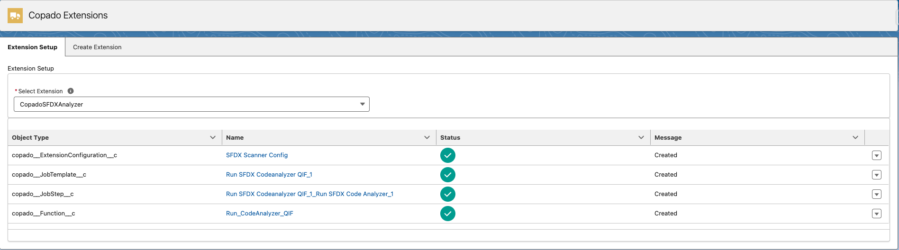

### 3. Create the quality gate

- Navigate to Pipeline Builder.
- Go to the Quality Gates sub-section from the left-hand side pane.
- Click the `Create Quality Gate` button, and choose `sfdx-scanner` from the list.
- You can choose to create it `After Commit - Block`, `After Promotion - Report`, or `Before Deployment - Block`, depending on the behavior you need.
- You can configure the environment(s) and/or stage(s) the quality gate should apply to.

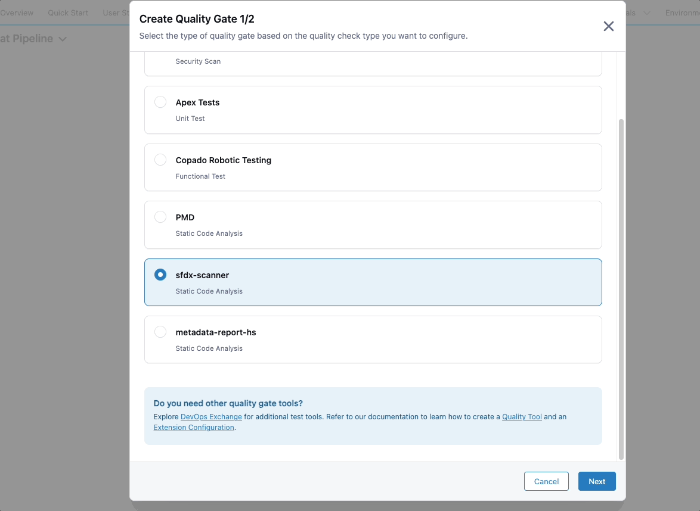

For example, here is an After Commit quality gate configured with **Advanced Filters** so it triggers only when at least one metadata item of type **Apex** (`ApexClass`, `ApexTrigger`, `ApexComponent`, `ApexPage`), **LWC**, **Flow**, or **Messaging Channel** is committed:

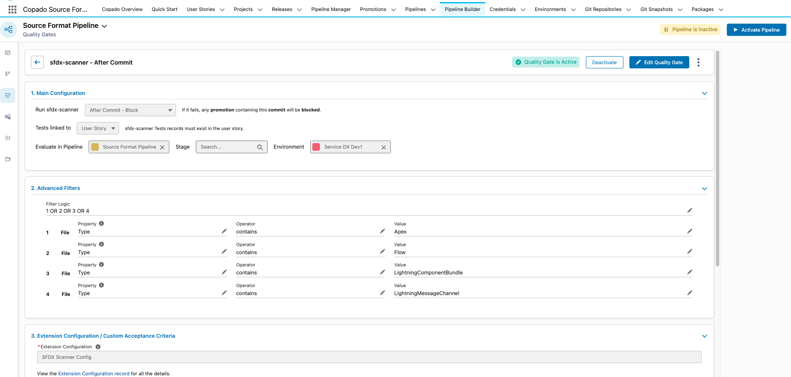

| Lifecycle                 | Changes analyzed                                                                                     | Effect of a failing gate                                                |
| ------------------------- | ---------------------------------------------------------------------------------------------------- | ----------------------------------------------------------------------- |
| After Commit — Block      | Only the changes introduced in the user story's feature branch since it branched off its base branch | 🔴 Prevents the story from proceeding through the normal promotion flow |
| After Promotion — Report  | Combined changes in the promotion branch since it branched off the destination branch                | 🟡 Reports findings; does not block or wait for deployment              |
| Before Deployment — Block | Combined changes in the promotion branch since it branched off the destination branch                | 🔴 Prevents deployment from starting                                    |

### 4. Configure the severity threshold (Optional, but recommended)

The default threshold is **2 (High)**. To override it, open your pipeline's
**Settings → System Properties** and create a property with both Name and API
Name set to `sfdx_scanner_severityThreshold`, using a value from `1` to `5`.
Use a public/non-secret property; leave unrelated settings at their defaults.
Missing or invalid values fall back to `2`.

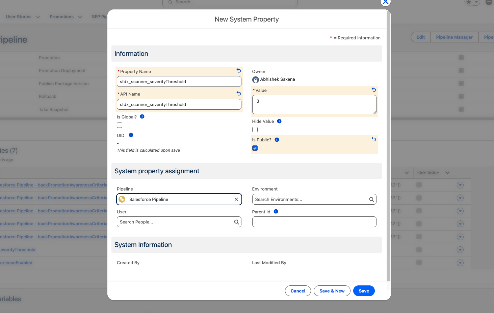

| Value | Severity |
| ----- | -------- |
| 1     | Critical |
| 2     | High     |
| 3     | Moderate |
| 4     | Low      |
| 5     | Info     |

A gate fails when a finding has a severity number **less than or equal to** the
threshold. For example, threshold `2` fails on Critical or High findings but
passes when there are only Moderate, Low or Info findings. Passing does not
necessarily mean there are no findings.

### 5. Customize engines and rules (Optional)

All enabled engines run automatically out of the box. Add a `code-analyzer.yml` or
`code-analyzer.yaml` file at the root of your repository to enable or disable
specific engines, adjust rule severities, or add custom rules.

For example, to disable only the ApexGuru engine while keeping all other engines enabled:

```yaml
engines:
  apexguru:
    disable_engine: true
```

Commit the configuration to the appropriate environment branches through your
normal review process so feature and promotion branches inherit it. See
[Salesforce's configuration documentation](https://developer.salesforce.com/docs/platform/salesforce-code-analyzer/guide/config-custom.html)
and the repository's [scenario configuration examples](test-data/configs/).

## Testing the setup

If you've set up the `After Commit` Quality Gate as above, commit changes that include Apex classes, LWCs, Apex components, flows, or messaging channels on a user story tied to the environment/stage where your Quality Gate is configured. The Commit Action will then invoke `Code Analyzer` after every commit.

Here's some [test metadata](./test-data/) that can be used to test the Quality Gate, and (optional)sample [configuration files](./test-data/configs/).

## ApexGuru in the upcoming 4.0 release

ApexGuru analyzes changed Apex classes (`.cls`) and triggers (`.trigger`). Its
findings appear alongside the local engines' findings and participate in the
configured severity threshold.

The extension uses the existing Copado **source environment credential**:

- **After commit:** the user story's source environment.
- **After promotion / before deployment:** the promotion's source environment,
  not the destination org.

| Mode                     | Meaning                                                                                                       |
| ------------------------ | ------------------------------------------------------------------------------------------------------------- |
| **Full** (Advanced Mode) | Uses runtime-aware insights when your org (or its parent org family) has ApexGuru enabled in Salesforce Setup |
| **Static** (Basic Mode)  | Performs static code analysis when neither your org nor its parent org family has ApexGuru enabled            |

Code Analyzer selects the mode automatically based on your org's settings — even if ApexGuru is not enabled in your org, it still runs an ApexGuru scan in **static** mode. For more details on how scan modes and org inheritance work, see [Salesforce's ApexGuru Engine documentation](https://developer.salesforce.com/docs/platform/salesforce-code-analyzer/guide/engine-apexguru.html).

If there are no Apex changes, ApexGuru is disabled, or authentication/remote
analysis is unavailable, the extension skips remote analysis and preserves the
local-engine report. Review warnings and status rather than treating a skipped
scan as successful ApexGuru coverage. Local findings can still fail the gate.

# In-depth walkthrough and reviewing results

Commit a small change through a story covered by the gate, then open its Test and
Result records. The result viewer supports engine/rule and metadata-type/file
grouping, severity filters, search and expandable findings. Open the Result
record directly for more space. The attached `output.json` contains the report,
engine versions and ApexGuru insights.

## Trigger points in action

### After Commit

|                                                        |                                                                    |
| ------------------------------------------------------ | ------------------------------------------------------------------ |
| 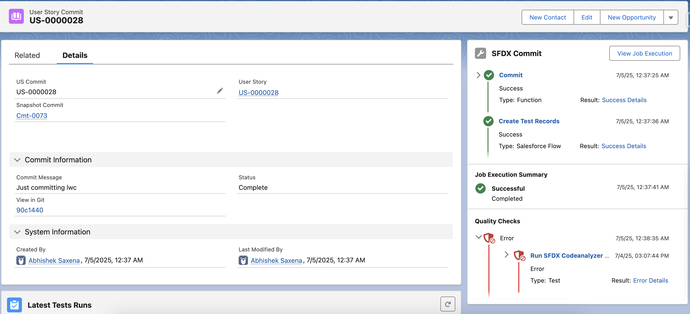 | 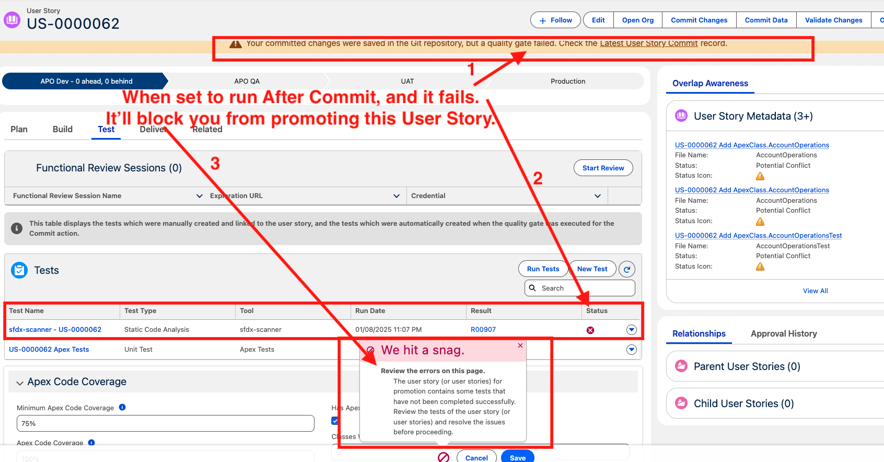 |

### Before Deployment

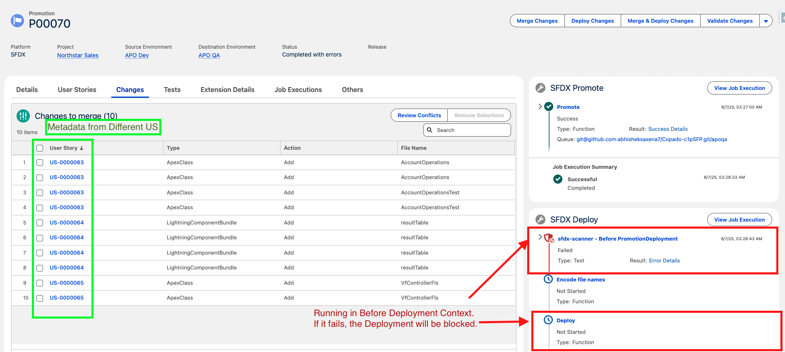

### After Promotion

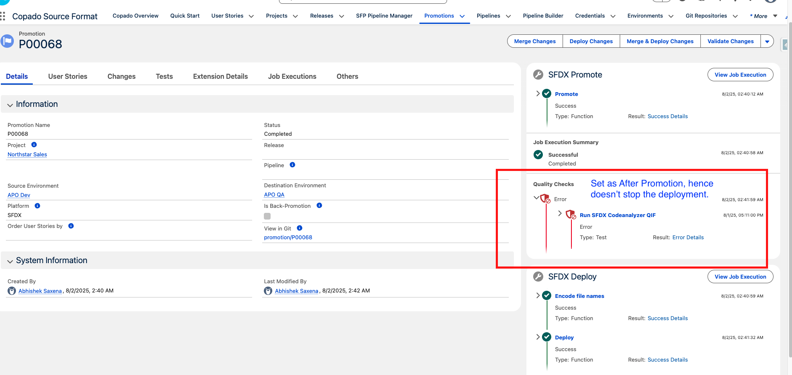

## Reviewing the scan results

### Engine and rule grouping

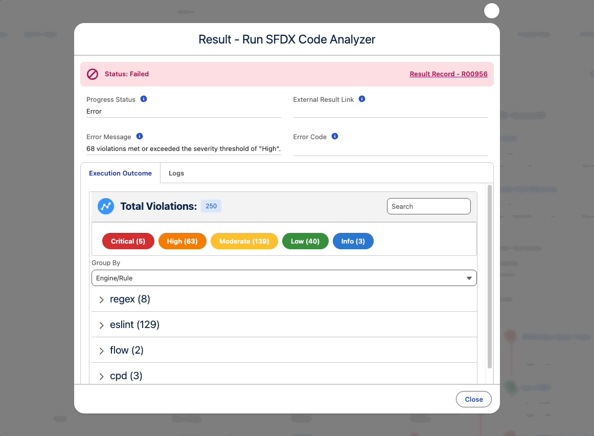

### Metadata type and filename grouping

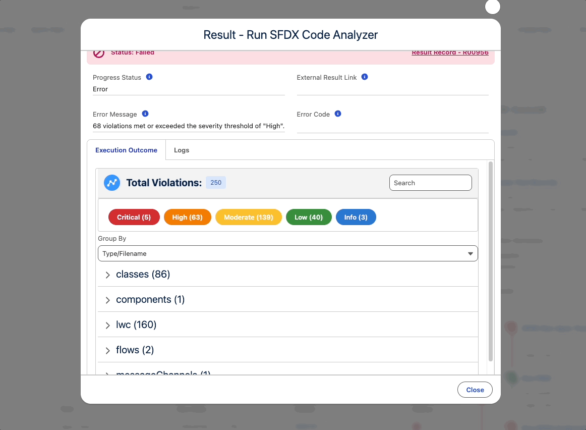

### Severity filters and search

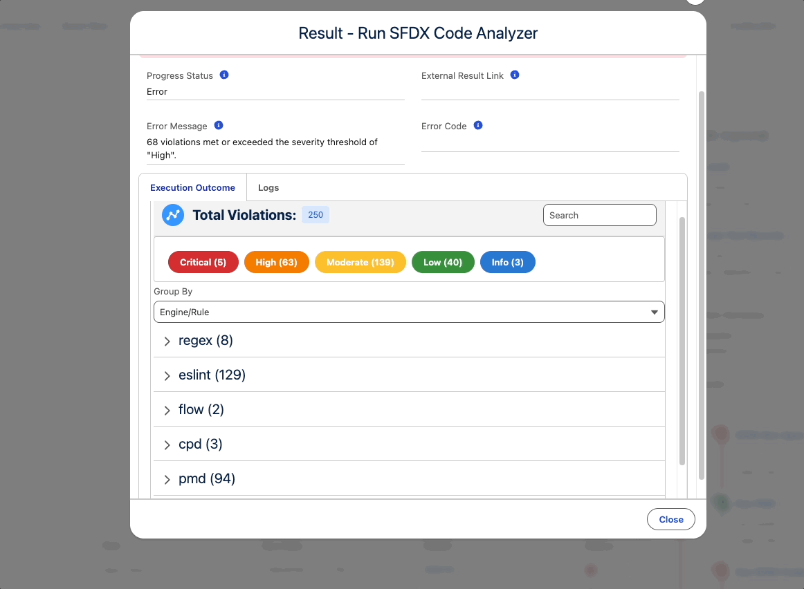

### Full Result record view

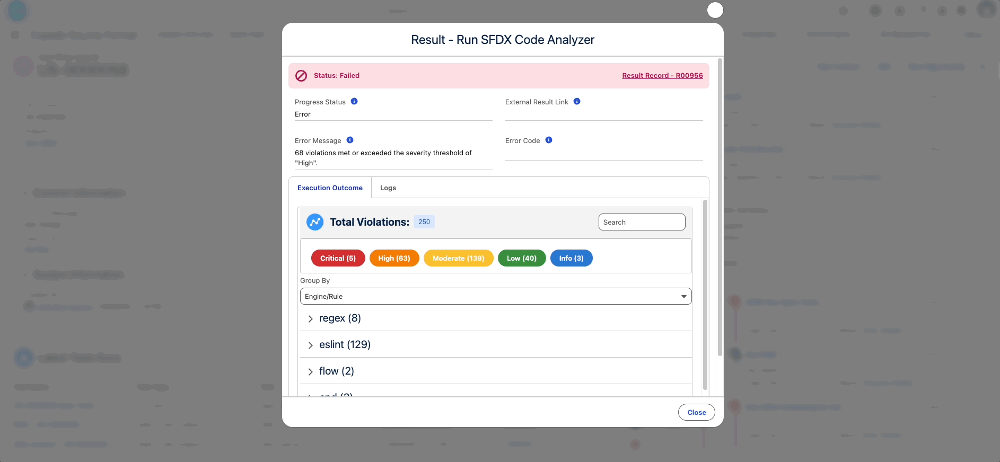

## Contributing and verification

- [CONTRIBUTING.md](CONTRIBUTING.md): development setup, source synchronization,
  deployment and packaging workflow.
- [TESTING.md](TESTING.md): local, unpackaged integration and packaged verification.
- [Scenario catalog](test-data/assertions/scenarios.v1.json): TC1–TC13 and recovery/UI
  scenario definitions.
- [Release verification](docs/releases/apexguru-verification.md): tested build,
  outcomes and unexecuted checks.
- [AGENTS.md](AGENTS.md): additional instructions for coding agents.

Run `npm run verify:local` for local contract and mocked Function checks.
`npm run verify:container` provides optional container verification; consult the
testing policy when image or runtime dependencies change.
